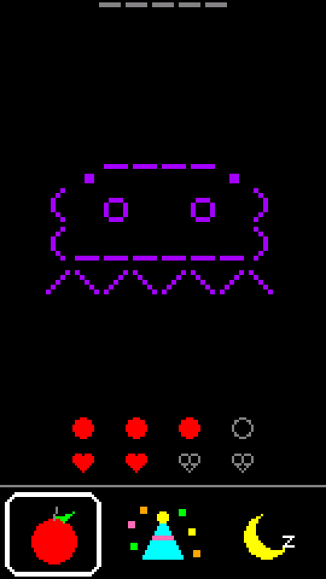
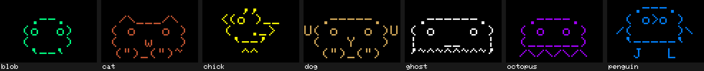

# m5stack-pet

A small offline virtual pet for the M5StickS3. An egg hatches into an ASCII
animal that you feed, dance with, take for walks and put to bed. There is no
Bluetooth, no Wi-Fi and no app. It is made for young kids, so nothing on the
main screens needs reading and the pet can't die.

<p align="center">
  
</p>

<p align="center">
  
</p>

The idea comes from
[claude-desktop-buddy](https://github.com/anthropics/claude-desktop-buddy),
a desk companion that shows what Claude is doing. This project keeps its
ASCII animals and leans all the way into the pet, with the Claude and
Bluetooth parts taken out.

> **Status: early.** It runs on real hardware and is being tested by two
> small kids. Expect timings and details to change.

## Install

You need an [M5StickS3](https://docs.m5stack.com/en/core/StickS3),
[PlatformIO Core](https://docs.platformio.org/en/latest/core/installation/)
and a USB-C cable.

```bash
git clone https://github.com/mjnitz02/m5stack-pet.git
cd m5stack-pet
make flash     # compile and upload over USB
```

It boots to an egg. Press the blue button a few times to hatch it.

If the upload can't connect, plug in USB, hold the side power button until
the inner green LED blinks, then run `make flash` again.

## Docs

- [Playing](docs/playing.md): the pet screen, buttons, and the parent screen.
- [Toy box](docs/toy-box.md): the twelve activities and the rules they keep.
- [Animals](docs/animals.md): the seven animals and how to draw another.
- [Battery](docs/battery.md): how it saves power and how to measure it.
- [Development](docs/development.md): make targets, code layout, tuning.

## License

MIT, see [LICENSE](LICENSE). The animal art, the renderer and the original
firmware are from
[claude-desktop-buddy](https://github.com/anthropics/claude-desktop-buddy)
by Anthropic.
