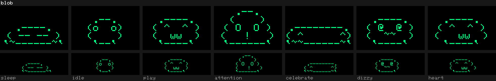
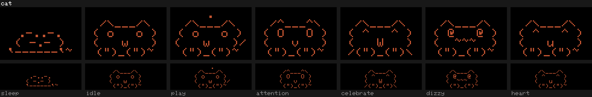
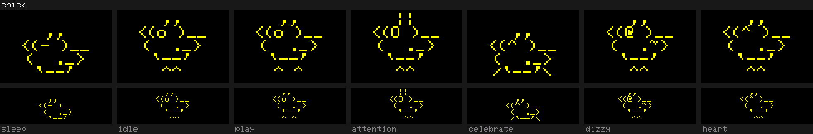
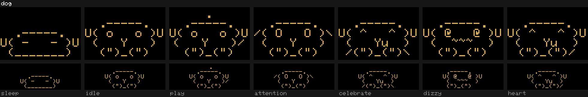
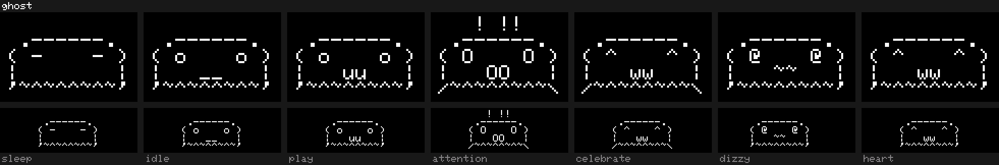
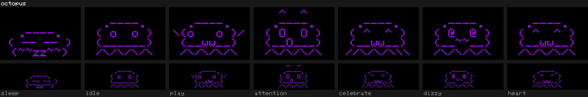
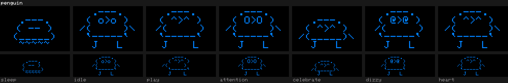

# Animals

Seven animals, picked by two small testers. An egg hatches any of them unless
the parent screen's `pet` line names one.

| Animal | Colour | Notes |
| --- | --- | --- |
| **Blob** | Green | A wobbly jelly that melts into a puddle to sleep. |
| **Cat** | Rust | Twitching ears and tail; knocks things off tables. |
| **Chick** | Yellow | Started as a duck that the testers called a chicken. Pecks at seeds. |
| **Dog** | Tan | The cat's body with floppy ears; pants, wags and noses a ball along. |
| **Ghost** | White | Friendly. Floats, and fades out and back in its sleep. |
| **Octopus** | Purple | The original favourite. Waves its legs. |
| **Penguin** | Blue | Flippers and two feet. |

The animals that stayed all have a body with legs or feet. The ones that were
cut (among them an owl, a rabbit, a snail and a turtle) were mostly faces.

## The seven animations

Every animal has the same seven, each a short loop of poses plus a few
drifting characters such as Zs, hearts or confetti.

| Animation | When it plays |
| --- | --- |
| sleep | Bedtime, the second half of Rock to sleep, eyes shut in Freeze |
| idle | Most of the time |
| play | Now and then on the pet screen, for twelve seconds in every 48, when neither need row is empty. Each animal has its own game: the blob bounces a ball on its head, the cat and the dog have a ball, the chick pecks at a seed, the ghost plays peekaboo, the octopus juggles and the penguin skates. |
| attention | A need row is empty; watching in Freeze |
| celebrate | Hatching, dancing, finishing an activity, a favourite food |
| dizzy | The stick was shaken; a miss in Freeze or Copycat |
| heart | Fed, a good moment in an activity, now and then when both rows are full |

Each picture below shows the first pose of every animation, at the pet
screen's size on top and the smaller activity size underneath.

These are drawn by `make species` with the stick's own font and layout
rules, so the shapes match the device pixel for pixel. Particles, hats and
dress-up colours are left out.

## Drawing rules

An animal is one file in `src/buddies/` with seven functions, one per
animation. A pose is five strings, one per row.

- **Five rows** per pose, always.
- **Eleven characters wide at most**, not counting padding. The pet screen
  draws at double size and that is all that fits across it.
- **Plain ASCII only.** The stick's font has nothing else, and a stray
  accent comes out as the wrong glyph and pushes its row off centre.
- **Centre the ink in each string.** The pet screen trims every row and
  centres it by itself, but the activity size keeps the padding. Rows whose
  ink is not centred the same way line up on one and not the other.
- **Go easy on backticks.** In this font they are heavy blobs.
- **Give it a body.** Legs or feet, not a floating face.

`make test` checks the first three, and that every file is registered.

## Adding or removing one

1. Add or delete the file in `src/buddies/`. Copying `cat.cpp` is the
   easiest start; the dog was made that way.
2. Add or delete its two lines in `SPECIES_TABLE` in `src/buddy.cpp`.
3. Run `make test species` to check the art and redraw the pictures.

The stick saves its pet as a position in `SPECIES_TABLE`. Adding to the end
is safe. Removing or reordering changes what every saved position means, so
it also needs `PET_ROSTER` raised in `src/pet.h` and a row in
`petMigrateRoster()` that maps the old positions to the new ones. A pet
whose animal is gone goes back to an egg and keeps its stickers.
