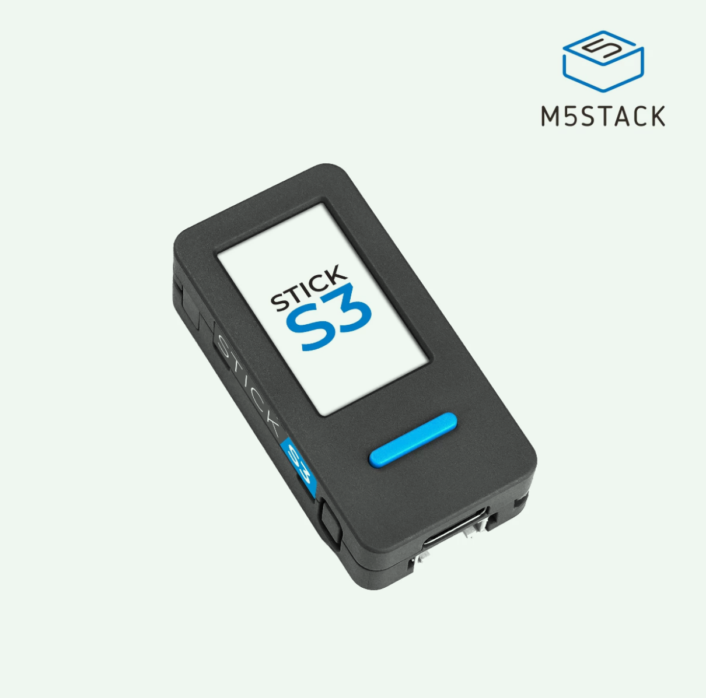

# Development

## Hardware

Built for the **M5StickS3** (ESP32-S3, 135 x 240 LCD, two buttons, an
accelerometer and a small speaker). The older **M5StickC Plus** also compiles
from the same code through [M5Unified](https://github.com/m5stack/M5Unified),
but is not the board this is tested on.



## Make targets

You need [PlatformIO Core](https://docs.platformio.org/en/latest/core/installation/),
and for the Python tools [uv](https://docs.astral.sh/uv/).

| Target | Runs |
| --- | --- |
| `make build` | Compile for the M5StickS3 |
| `make flash` | Compile and upload over USB |
| `make monitor` | Serial log: battery mV and awake minutes every 10 seconds |
| `make flash-debug` | Flash with the on-device log compiled in |
| `make log` | Copy that log to `logs/` (stick awake and on USB) |
| `make log-clear` | Empty it |
| `make test` | Checks on the animal art, then the firmware tests below |
| `make test-host` | The firmware tests alone, on this computer |
| `make test-host-update` | Rewrite the stored traces in `test/golden/` |
| `make lint` | ruff on `tools/`, then a build with warnings as errors |
| `make species` | Redraw `docs/species/*.png` and `docs/home.png` |
| `make install-hooks` | Pre-commit hook: ruff, art checks, secret scan |

Add `PIO_ENV=m5stickc-plus` to any of the build targets for the older board.

**Download mode:** if the stick is running other firmware and the upload
can't connect, plug in USB and hold the side power button until the inner
green LED blinks, then run `make flash` again.

## Tests

`make test-host` compiles the real `src/` for your computer against a fake
stick (`test/fakes/`) and plays it: a test presses the buttons, moves the
stick about and lets time pass, then checks what the firmware did. It needs
only a C++ compiler. Time is simulated, so an hour's nap takes no time at all
and every run is identical. Each simulated boot is a process of its own, so a
nap or a power-off really does start the firmware again from what it saved.

```cpp
TEST(home_left_alone_goes_to_bed) {
  Device d = hatchedPet();
  d.boot(Wake::Button, [](Stick& s) {
    s.run(61000);
    CHECK_EQ(probe::screen(), "bed");
  });
}
```

There are two kinds of test in `test/host/`:

- **Behaviour tests** (`test_boot`, `test_home`, `test_power`, `test_holds`,
  `test_parent`, `test_saved`, `test_activities`) say what should happen.
- **Stored traces** (`test_golden`) play each screen through and compare
  every beep, save, brightness change and power event, and a checksum of the
  drawing in each second, with a file in `test/golden/`. They say only that
  nothing has changed, which is the check a tidy-up of the code needs. When
  a change is meant to alter a screen, run `make test-host-update` and read
  the diff of `test/golden/` before keeping it.

`HOST_TEST=text make test-host` runs the tests with `text` in their name.
`SIM_DUMP=out.txt` writes every drawing call, for finding what moved when a
checksum differs.

Tests read the firmware's state through `test/host/probe.h` and nothing
else, so `firmware.cpp` is the one file there that has to follow when `src/`
is reorganised.

What this cannot see: real deep sleep and battery drain, the sound, and how
the movement numbers feel in small hands. [smoke-test.md](smoke-test.md) is
the short list to run on a real stick for those.

## Layout

```
src/
  main.cpp       - game loop, core screens, toy box, power handling
  activities.h   - the toy box activities
  icons.h        - every icon, drawn from shapes
  pet.h          - saved state (needs, settings, stickers, dress-up)
  petlog.h       - the debug build's on-device log
  buddy.cpp      - animal registry and ASCII render helpers
  buddies/       - one file per animal, seven animation functions each
  palette.h      - every colour
  compat.h       - maps the old display type name onto M5Unified
test/
  fakes/         - stand-ins for M5Unified, Arduino and the ESP32 calls
  host/          - the simulated stick, the probes and the tests
  golden/        - stored traces
tools/
  species.py         - parses the animal art out of src/buddies/
  render_species.py  - draws docs/species/*.png and docs/home.png
  glcdfont.py        - the stick's font, for those drawings
  test_species.py    - art checks
  pull_log.py        - reads the on-device log over USB
```

## Tuning

The numbers that decide how the toy feels sit at the top of their sections
as named constants. The movement ones are guesses until they have been tried
in small hands.

| What | Where | Constants |
| --- | --- | --- |
| Time to bed, nap and power-off | `main.cpp` | `IDLE_BED_MS`, `BED_OFF_MS`, `NAP_MS` |
| How fast apples and hearts drop | `main.cpp` | `HUNGER_DECAY_MS`, `HAPPY_DECAY_MS` |
| Taps to hatch | `main.cpp` | `EGG_TAPS` |
| How hard a shake is | `main.cpp` | `SHAKE_DELTA` |
| Sticker odds | `main.cpp` | `STICKER_ODDS` |
| Catch speed and basket width | `main.cpp` | `FALL_PX_MS`, `CATCH_HALF` |
| Sound level | `main.cpp`, `setup()` | `M5.Speaker.setVolume(90)` |
| How much moving each activity needs | `activities.h` | `WALK_PER_DOT`, `DANCE_PER_BAR`, `BATH_PER_BUBBLE`, `ROCK_PER_CROSS` |
| Freeze: how still, for how long | `activities.h` | `FREEZE_MOVE`, `FREEZE_GRACE_MS`, `FREEZE_HOLD_MS` |
| Pen and marble feel | `activities.h` | `PEN_SPEED`, `MARBLE_ACCEL`, `MARBLE_DRAG` |

If the side button is on the left of your board, Copycat's white bar should
be too: set `SIDE_BAR_X` to 6.
